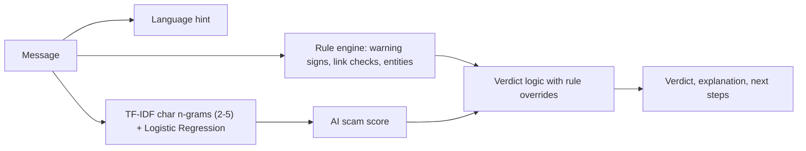

<p align="center">
  
</p>

<h1 align="center">BlackVault AI</h1>
<p align="center"><b>Scam message screening for English and Roman Urdu - with explanations you can act on.</b></p>

<p align="center">
  
  
  
  
  
</p>

<p align="center">
  
  
</p>

BlackVault AI takes a suspicious SMS, WhatsApp message or email and answers three questions: **is it likely a scam, why, and what should I do next?** It is built for the way scams actually reach people in Pakistan - English, Roman Urdu and mixed messages that ask for an OTP, a PIN, a CNIC or a small "fee".

It is a **defensive screening aid, not a security guarantee.** Every number in this document comes from a file in [`results/`](results/), including the results that did **not** work out - see [Results and honest limitations](#results-and-honest-limitations).

---

## Table of contents

1. [Why BlackVault AI](#why-blackvault-ai)
2. [Features](#features)
3. [How it works](#how-it-works)
4. [Results and honest limitations](#results-and-honest-limitations)
5. [Installation](#installation)
6. [Usage guide](#usage-guide)
7. [API reference](#api-reference)
8. [Project structure](#project-structure)
9. [Testing](#testing)
10. [Deployment](#deployment-streamlit-community-cloud)
11. [FAQ](#faq)
12. [Troubleshooting](#troubleshooting)
13. [Privacy and responsible use](#privacy-and-responsible-use)
14. [Roadmap](#roadmap)
15. [Contributing](#contributing)
16. [Data and credits](#data-and-credits)
17. [License](#license)

---

## Why BlackVault AI

Scam detectors that only work in English miss most of the messages Pakistani users actually receive. A model trained only on English SMS spam, tested on Roman Urdu phishing text, recalls **4.9%** of scams (see the table below) - it is barely better than not checking at all. BlackVault AI exists to close that gap, and to be transparent about how far the gap is actually closed:

- it screens **English and Roman Urdu** with one model family,
- it explains **why** a message was flagged instead of returning a bare score,
- it checks links and extracts phone numbers/amounts **offline**, without ever opening a link,
- and it says plainly where it still fails, instead of hiding the hard cases.

## Features

| Capability | Description |
|---|---|
| **AI scam score** | Character n-gram TF-IDF + logistic regression, trained on English and Roman Urdu messages. |
| **Rule engine** | Explainable warning signs: urgency, secret-code requests (OTP, PIN, password, CNIC), money or fee talk, bank impersonation, threats and lures. |
| **Offline link inspector** | Flags http-only links, raw IP hosts, URL shorteners, odd TLDs, punycode, `@` tricks and hyphenated look-alike domains. The link text is parsed; the link is never fetched or opened. |
| **Why it was flagged** | Leave-one-word-out attribution highlights the words that pushed the score up. |
| **Verdict logic with overrides** | Three score bands plus rule overrides: a message that asks for secret codes *and* carries a risky link is escalated even when the model score alone is low. The UI states which one decided. |
| **Scam type guess** | Bank or wallet phishing, prize or aid payout, courier fee, investment or fake job, bill or authority threat. |
| **Batch mode** | Check up to 30 messages at once and export a CSV. |
| **Actionable output** | Plain next steps, a copy-ready family warning, a downloadable report, and a built-in scam guide. |
| **Bilingual UI** | English and Roman Urdu, switchable with one click, without losing your current result. |
| **Privacy by design** | Messages are processed in memory only. Nothing is logged or written to disk. |

## How it works



**The model.** `TfidfVectorizer(analyzer="char_wb", ngram_range=(2, 5))` feeding `LogisticRegression(class_weight="balanced")`. Character n-grams tolerate Roman Urdu spelling variation (`foran`, `foraan`, `fauran` all share sub-sequences) without needing a fixed vocabulary or a tokenizer for an unstandardized script.

**The verdict.** The AI score is banded into three levels - below 35% is low, 35-65% is uncertain, above 65% is high - and then a small rule layer can raise (never lower) the level: a message that both asks for a secret code *and* carries a risky link is always escalated, regardless of score. These cut-offs are demo choices, not statistically validated thresholds, and the UI says so on every result.

**The explanation.** For messages up to 80 words, each word is temporarily removed and the model is re-scored; a word whose removal drops the score by 3 points or more is highlighted. This is a leave-one-word-out attribution, not a learned explanation model - simple, but it only ever shows evidence the model actually used.

**Code map:**

| File | Responsibility |
|---|---|
| `src/app/model.py` | Training (`train_in_memory`), persistence, fallback loading, `predict_text()` |
| `src/app/analysis.py` | Rule-based warning signs, URL inspection, entity extraction, verdict logic |
| `src/app/streamlit_app.py` | The UI: layout, tabs, state |
| `src/app/theme.py` | CSS, animations, logo, score gauge |
| `src/app/i18n.py` | All English and Roman Urdu UI strings |
| `src/app/api.py` | Optional FastAPI wrapper |

## Results and honest limitations

### Text classification

| Experiment | Precision | Recall | F1 | False-positive rate |
|---|---|---|---|---|
| English baseline, UCI SMS Spam test set (confusion matrix `[[898, 5], [7, 124]]`) | 0.961 | 0.947 | 0.954 | 0.0055 |
| English-only model applied to Roman Urdu | 0.299 | 0.049 | 0.085 | 0.079 |
| Roman Urdu only, **template held-out** | 0.974 | 1.000 | 0.987 | 0.018 |
| English + Roman Urdu, **template held-out** | 0.981 | 1.000 | 0.990 | 0.013 |
| Roman Urdu only, **scam-type held-out** | 0.936 | 0.973 | 0.954 | 0.045 |
| English + Roman Urdu, **scam-type held-out** | 0.823 | 0.973 | 0.891 | 0.143 |

What these numbers mean, and do not mean:

- **An English-only model collapses on Roman Urdu** (recall 0.049). A bilingual model is a requirement, not a nice-to-have.
- **The Roman Urdu dataset is highly templated:** 1,000 messages come from only 189 templates. A random split would leak templates between train and test and report near-perfect, meaningless scores. We found and fixed this leak with a union-find over masked message fingerprints; `src/text/check_leakage.py` now reports zero template overlaps. All numbers above use **template-held-out** or **scam-type-held-out** splits - the model is tested on wording and scam categories it has not seen.
- **Held-out scam types are the harder, more honest test.** Adding English data to the Roman Urdu model actually *raised* the false-positive rate on unseen scam types (0.045 to 0.143) - more data was not an unqualified improvement.
- **Known blind spots** from error analysis: the "Wrong Number Refund Scam" type was caught 0 of 11 times; "Utility Bill Payment Reminder" only 25 of 46 (54.3%).
- The model shipped in the live demo is trained on all available rows, so **it carries no performance claim of its own** - the table above is the evidence, produced on held-out splits during development.

### Audio deepfake detection (experimental, disabled in the app)

wav2vec2-base embeddings + logistic regression, evaluated on In-The-Wild with speaker-disjoint splits:

| Setting | EER | AUC |
|---|---|---|
| In-The-Wild, 5-fold speaker-disjoint CV (3,000 clips) | 0.128 +/- 0.064 | 0.942 +/- 0.046 |
| Trained on In-The-Wild, tested on DFE-Val (102 clips) | **0.539** | **0.438** |

The detector performs well in-domain and **fails to generalize across datasets - effectively chance level** (EER 0.5 and AUC 0.5 are chance). For that reason the app ships no audio detector: `/analyze/audio` intentionally returns HTTP `501`. Scripts for layer-wise evaluation and MP3-codec robustness live in `src/audio/`; their results have **not been produced yet**, and nothing is claimed about them until they are.

## Installation

### Prerequisites

- Python 3.11 (Windows, macOS or Linux)
- Git
- About 300 MB free disk space for dependencies

### Windows (PowerShell)

```powershell
git clone https://github.com/Sidra-009/blackvault-ai
cd blackvault-ai
python -m venv .venv
.\.venv\Scripts\Activate.ps1
pip install -r requirements.txt

python src/app/model.py                       # trains and saves models/text_model.joblib
streamlit run src/app/streamlit_app.py        # opens the app in your browser
```

### macOS / Linux

```bash
git clone https://github.com/Sidra-009/blackvault-ai
cd blackvault-ai
python3 -m venv .venv
source .venv/bin/activate
pip install -r requirements.txt

python src/app/model.py
streamlit run src/app/streamlit_app.py
```

If `models/text_model.joblib` does not exist (or fails to load, for example after a scikit-learn upgrade), the app trains the same pipeline in memory from `data/processed/` on first start - no separate step is required to run it.

## Usage guide

1. **Open the app.** `streamlit run src/app/streamlit_app.py` opens `http://localhost:8501`.
2. **Pick a language.** The sidebar toggle switches the whole UI between English and Roman Urdu without clearing your message or result.
3. **Paste a message**, or pick one of the four built-in examples from the sidebar, and press **Analyze message**.
4. **Read the verdict.** Three tiles show the verdict (with the reason it was reached), the AI scam score as a gauge, and the detected language.
5. **Open the explanation tabs:**
   - *Why flagged* - the words that pushed the score up, highlighted in the message.
   - *Warning signs* - which rule-based red flags matched (urgency, secret-code request, money talk, impersonation, threat/lure).
   - *Links and details* - every link found, with its specific problems (no HTTPS, raw IP, shortener, odd TLD, punycode, look-alike domain), plus any phone numbers or amounts mentioned.
   - *What to do* - concrete next steps for this result.
   - *Share and report* - a ready-to-send family warning and a downloadable `.txt` report.
6. **Batch check.** Switch to the *Batch check* tab, paste up to 30 messages (one per line), and export the results as CSV.
7. **Scam guide.** The *Scam guide* tab explains the five common scam patterns the app recognizes and five general safety rules, independent of any single message.

## API reference

An optional FastAPI wrapper is included for programmatic access to the text model (the UI does not require it).

```powershell
pip install fastapi uvicorn
uvicorn src.app.api:app --port 8000
```

| Method | Endpoint | Body | Response |
|---|---|---|---|
| `GET` | `/health` | - | `{"status": "ok", "model_loaded": true, "audio_enabled": false}` |
| `POST` | `/analyze/text` | `{"text": "..."}` (1-5000 chars) | `{"risk": 0.0-1.0, "label": "scam" or "not scam", "language_hint": "english" or "roman_urdu", "disclaimer": "..."}` |
| `POST` | `/analyze/audio` | any | `501 Not Implemented` - audio detection is disabled; see [Results](#results-and-honest-limitations) for why |

No request is logged or persisted by the API.

## Project structure

```text
src/app/        Application: UI, rule engine, model, API, theme, i18n strings
src/text/       Data preparation, baselines, cross-validation, leakage check, error analysis
src/audio/      wav2vec2 feature extraction, layer-wise and codec-augmentation experiments (Colab)
tests/          Rule-engine, API, UI smoke, and model-fallback tests
results/        Written-up experiment results - the source of every number in this document
data/           Processed data and data documentation
assets/         Logo
docs/           Screenshots used in this README
```

## Testing

```powershell
python -m pytest tests -q              # unit tests: rule engine, API, model fallback
python tests/smoke_ui.py               # headless, end-to-end UI check with the real model
```

`tests/smoke_ui.py` drives the actual Streamlit app with `streamlit.testing.v1.AppTest`: it selects an example, clicks Analyze, switches language, and asserts the result renders - the closest thing to opening the app in a browser that still runs unattended.

## Deployment (Streamlit Community Cloud)

1. Push this repository to GitHub.
2. On [share.streamlit.io](https://share.streamlit.io), choose **New app**, and pick this repository and the `main` branch.
3. Set the main file path to `src/app/streamlit_app.py`.
4. Under **Advanced settings**, choose **Python 3.11**.
5. Deploy. The first load trains the model in memory (a few seconds); no secrets are required and no data leaves the app.

## FAQ

**Does it work on messages that mix English and Roman Urdu?**
Yes - the character n-gram model does not require language detection first; it scores the mixed text directly. The reported "detected language" is a lightweight heuristic for display only and does not affect the score.

**Why does a normal bill reminder sometimes get flagged?**
The rule engine looks for patterns common to both real reminders and scams (amounts, due dates, authority names). A low AI score with a rule-raised verdict means "some surface signals matched, but the model itself was not confident" - the UI shows which one decided (see [How it works](#how-it-works)).

**Can I trust a "no strong scam signs found" result completely?**
No. Read it as "nothing in our current rules or training data matched" - see [Results and honest limitations](#results-and-honest-limitations) for the specific scam types the model still misses.

**Does it detect voice note or call scams?**
Not yet in the shipped app. An audio deepfake detector was built and evaluated (see the table above) but disabled because it did not generalize across datasets. It is on the [roadmap](#roadmap).

**Is any message I check stored anywhere?**
No. Messages are processed in memory for the duration of the request and are never written to disk, logged, or sent anywhere else.

## Troubleshooting

| Problem | Likely cause | Fix |
|---|---|---|
| `ModuleNotFoundError: No module named 'streamlit'` | Virtual environment not activated, or dependencies not installed | Activate `.venv` and re-run `pip install -r requirements.txt` |
| App starts but every message scores near 50% | `models/text_model.joblib` failed to load and the in-memory fallback is training on incomplete data | Run `python src/app/model.py` directly and check its output for errors |
| `streamlit run` opens a blank page | Browser cached an old build | Hard refresh (`Ctrl+Shift+R`) or restart `streamlit run` |
| `pip install` fails with "No space left on device" | Default temp/cache directory is full | Set `TEMP`, `TMP`, and `PIP_CACHE_DIR` to a drive with space before installing |
| Roman Urdu messages are scored like gibberish | `data/processed/roman_urdu_zenodo.csv` is missing, so the model trained on English only | Confirm the file exists (see [Data and credits](#data-and-credits)) and retrain |

## Privacy and responsible use

- Messages are analyzed in memory and are never stored or logged, by the UI or the API.
- Links are inspected from their text only and are never fetched or opened.
- This project is strictly defensive: it helps people recognize scams, and contains no code to generate or send scam messages.
- A "low risk" result is **not** a safety guarantee. When in doubt, verify through your bank's official app or the number printed on your card - never a number or link from the message itself.

## Roadmap

- [x] Bilingual text scam detector with leakage-aware evaluation
- [x] Explainable verdicts, offline link inspector, batch mode, bilingual UI
- [ ] Layer-wise and codec-robustness results for the audio detector
- [ ] Voice-note scams: speech-to-text (Whisper) feeding the text model, fused with an audio score
- [ ] Probability calibration and statistically validated verdict thresholds
- [ ] More diverse Roman Urdu training data, targeted at the error-analysis blind spots above

## Contributing

Issues and pull requests are welcome. Before opening a PR:

```powershell
python -m pytest tests -q
python tests/smoke_ui.py
```

both should pass. If you add or change a scam-detection rule or a reported metric, update [Results and honest limitations](#results-and-honest-limitations) from a file in `results/` - this project's standard is that every number here is reproducible from that folder.

## Data and credits

- **Roman Urdu Phishing SMS Dataset for Smishing Detection Research.** Ghufran Siddiq, University of Management and Technology. Zenodo, DOI [10.5281/zenodo.21810885](https://doi.org/10.5281/zenodo.21810885). License: CC BY 4.0. The copy in `data/processed/` is a processed version (cleaned, deduplicated, with added template ids and masked fingerprints - see `data/README.md` for the exact changes).
- **SMS Spam Collection.** Almeida, Gomez Hidalgo and Yamakami (2011), UCI Machine Learning Repository.
- **In-The-Wild audio deepfake dataset.** Mueller et al. (2022), arXiv:2203.16263, CC BY-SA 4.0.
- **DFE-Val.** Hugging Face dataset `ALLA1N/In-the-wild_validation-dataset`.
- **wav2vec 2.0.** Baevski et al. (2020), `facebook/wav2vec2-base` via Hugging Face.

## License

Code is released under the MIT License (see [LICENSE](LICENSE)). Each dataset keeps its own license, listed above.